<p align="center">
  
</p>

<p align="center">
  
  
  
  
  
</p>

<h1 align="center">Savanna in Transition</h1>

<p align="center">
<b>Multi-Decadal Land Use and Land Cover Dynamics, Canopy Degradation Trajectories, and Multi-Sensor Ground-Truthing in the Sudan–Guinea Savanna Transition Zone of Southern Kebbi, Nigeria (2000–2026)</b>
</p>

<p align="center">
<b>Satwik K Udupi</b><br>
<sub>Junior Research Fellow (JRF), CCCSS, SUK · PravahaTattva Solutions, Karad</sub><br><br>
<i>in collaboration with</i><br>
<b>Yazid Abubakar Fakai</b><br>
<sub>PhD Scholar</sub>
</p>

---

> [!IMPORTANT]
> **Ownership.** This research, including its methodology, source code, maps, figures, tables and written analysis, was carried out by **Satwik K Udupi** (JRF, CCCSS, SUK · PravahaTattva Solutions, Karad) in collaboration with **Yazid Abubakar Fakai** (PhD Scholar), and is the intellectual property of **Yazid Abubakar Fakai**. It is published for viewing and academic reference only. No reuse, redistribution or derivative work is permitted without written permission. See [LICENSE](LICENSE) and [How to cite](#-how-to-cite).

## Contents

- [Overview](#-overview)
- [Key findings](#-key-findings)
- [Gallery](#-gallery)
- [Method](#-method)
- [Repository layout](#-repository-layout)
- [Reproducing the analysis](#-reproducing-the-analysis)
- [Data sources](#-data-sources)
- [References](#-references)
- [Credits](#-credits)
- [How to cite](#-how-to-cite)
- [Licence and ownership](#-licence-and-ownership)

## 🌍 Overview

The Sudan–Guinea savanna of north-western Nigeria is changing fast, and little of that change is monitored. This project covers all **seven Local Government Areas** of the **Southern Kebbi Senatorial District**: Danko-Wasagu, Fakai, Ngaski, Sakaba, Shanga, Yauri and Zuru. Together they span **12,294 km² (1,229,400 ha)**. The study measures 25 years of land-cover change, canopy degradation and forest-loss pathways.

What makes the approach new:

- **Multi-sensor triangulation.** The analysis combines seven independent Earth-observation products (Landsat, Esri Sentinel-2 LULC, ESA WorldCover, Hansen GFC, SRTM and MODIS VCF), so the result does not depend on any single closed dataset.
- **Benchmark-anchored pseudo-labelling.** Training samples are drawn only where recent 10 m global products agree, then fed to a class-balanced Random Forest on a 16-band spectral and terrain feature stack.
- **Pathway-resolved forest loss.** Deforestation is split into forest → agriculture, forest → grassland and forest → bare soil. High-confidence cores are confirmed with bi-temporal ΔNDVI and ΔNBR, then vectorised at a 0.45 ha minimum mapping unit.
- **Design-based validation.** Accuracy and area estimates follow Olofsson et al. (2014) good practice. Trends are cross-checked against Hansen annual loss and the MODIS MOD44B canopy series.
- **An honest error audit.** The report records the calibration pitfalls and how each was fixed: settlement over-prediction, WorldCover cropland inflation, aspect-ratio distortion, and TCC acronym confusion.

## 📊 Key findings

| Land-cover class | 2000 (ha) | 2000 % | 2026 (ha) | 2026 % | Net change (ha) |
| :--- | ---: | ---: | ---: | ---: | ---: |
| 🌳 Woodland / tree canopy | 249,565.7 | 20.30 | 199,949.6 | 16.26 | **−49,616.1** |
| 🌾 Cropland / agriculture | 372,624.9 | 30.31 | 598,161.2 | 48.65 | **+225,536.2** |
| 🌿 Grassland / savanna | 413,652.6 | 33.65 | 270,710.4 | 22.02 | **−142,942.2** |
| 🟫 Bare / degraded soil | 123,135.9 | 10.02 | 91,692.5 | 7.46 | **−31,443.4** |
| 💧 Open water | 63,743.4 | 5.19 | 61,405.4 | 4.99 | **−2,338.0** |
| 🏘️ Settlement / built-up | 6,575.8 | 0.53 | 7,481.4 | 0.61 | **+905.6** |
| **Total** | **1,229,400.0** | **100** | **1,229,400.0** | **100** | **0.0** |

**Where did the forest go?** Gross loss was 173,620 ha (MMU-sieved polygons):

| Pathway | Gross area | Polygons | Notes |
| :--- | ---: | ---: | :--- |
| Forest → Agriculture | 124,497 ha | 39,775 | 4,566 ha high-confidence core (ΔNDVI and ΔNBR confirmed) |
| Forest → Grassland | 34,628 ha | 13,490 | Selective felling, overgrazing, crown thinning |
| Forest → Bare / degraded | 14,495 ha | 5,854 | Gully erosion, laterite exposure, charcoal-kiln scars |

**Deforestation frontiers by total forest loss:** Danko-Wasagu (53,145 ha, 30.1 % of the district's forest-to-agriculture conversion), then Ngaski (35,857 ha) and Sakaba (27,118 ha, on fragile escarpment slopes).

**Validation highlights**

- Random Forest 5-fold cross-validation accuracy: **80.89 % ± 0.49 %** (2000) and **80.66 % ± 0.29 %** (2026).
- Olofsson design-based overall accuracy: **41.92 % ± 3.29 %** across the shifting-cultivation mosaic. User's accuracy is 88.8 % for water and 56.4 % for cropland. Full error matrices and adjusted areas are in [`docs/RESEARCH_REPORT.md`](docs/RESEARCH_REPORT.md).
- ΔNDVI vs ΔNBR coupling over degrading forest pixels: **R² = 0.686** (p < 0.0001, N = 3,216).
- MODIS MOD44B tree-cover trend from 2000 to 2024: **R² = 0.584** (p = 1.34 × 10⁻⁵), showing continuous canopy thinning.

## 🖼️ Gallery

<table>
  <tr>
    <td align="center">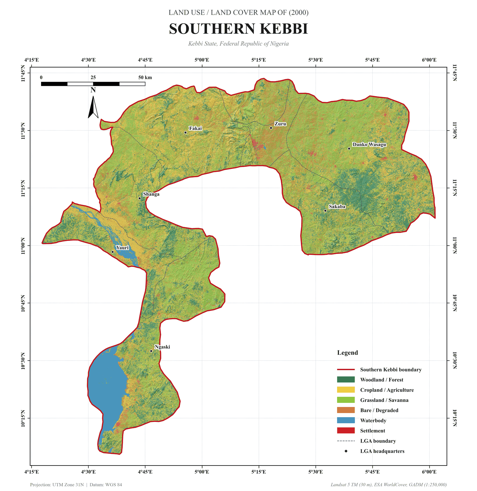<br><sub>Land cover, 2000 ↔ 2026</sub></td>
    <td align="center">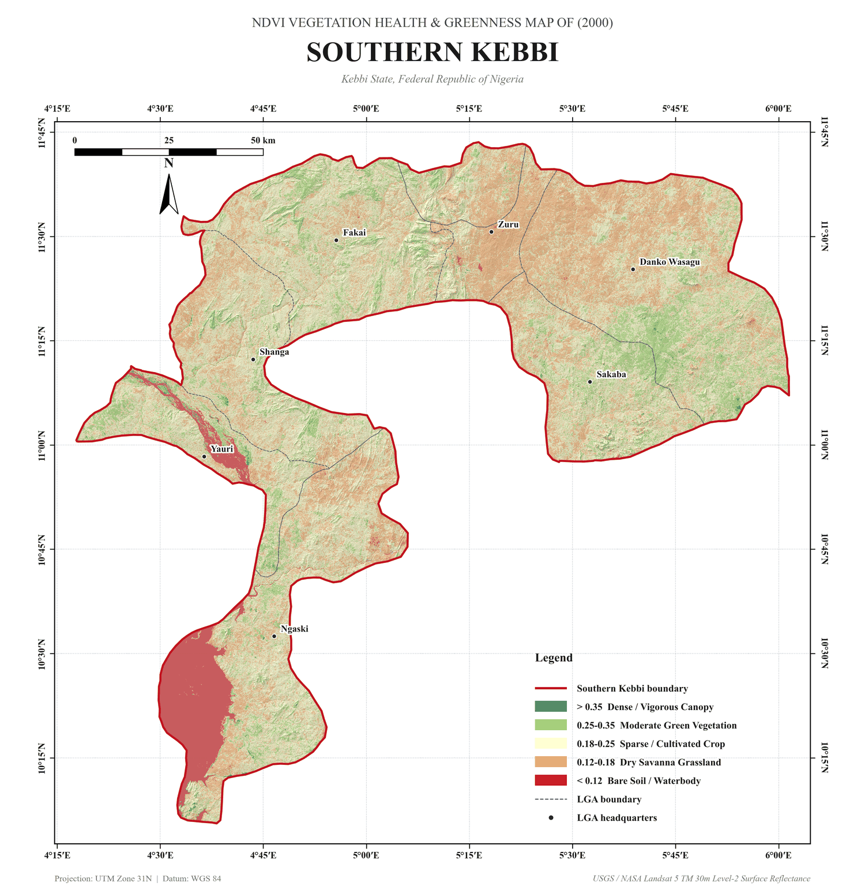<br><sub>NDVI, 2000 ↔ 2026</sub></td>
    <td align="center">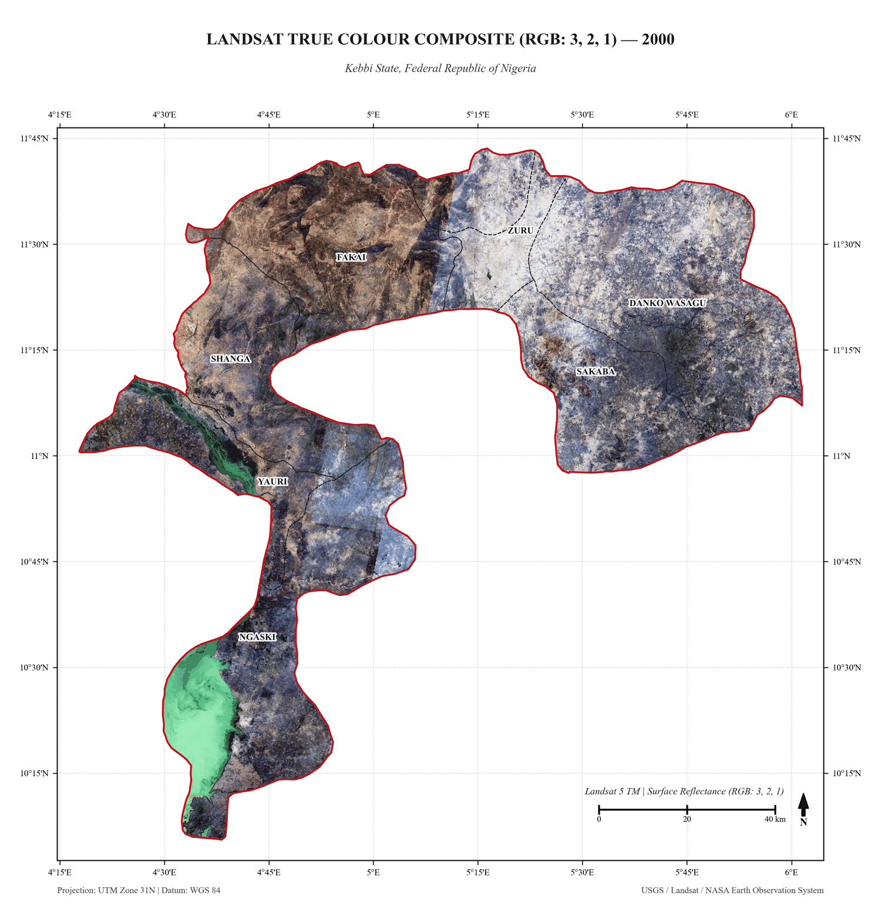<br><sub>True-colour composite, 2000 ↔ 2026</sub></td>
  </tr>
  <tr>
    <td align="center">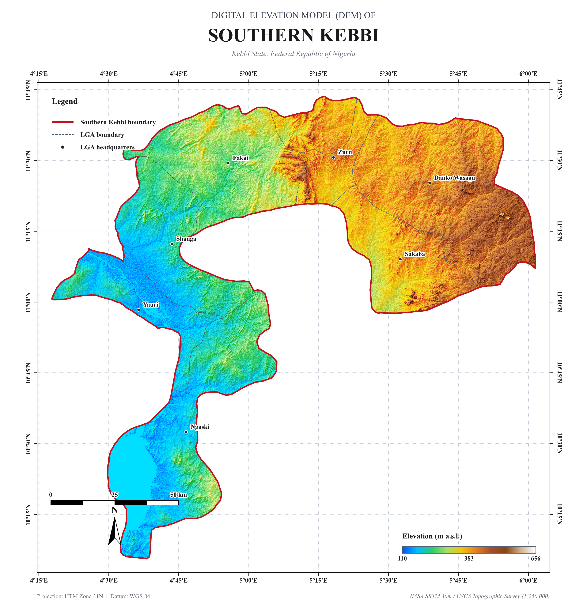<br><sub>Study area and relief</sub></td>
    <td align="center">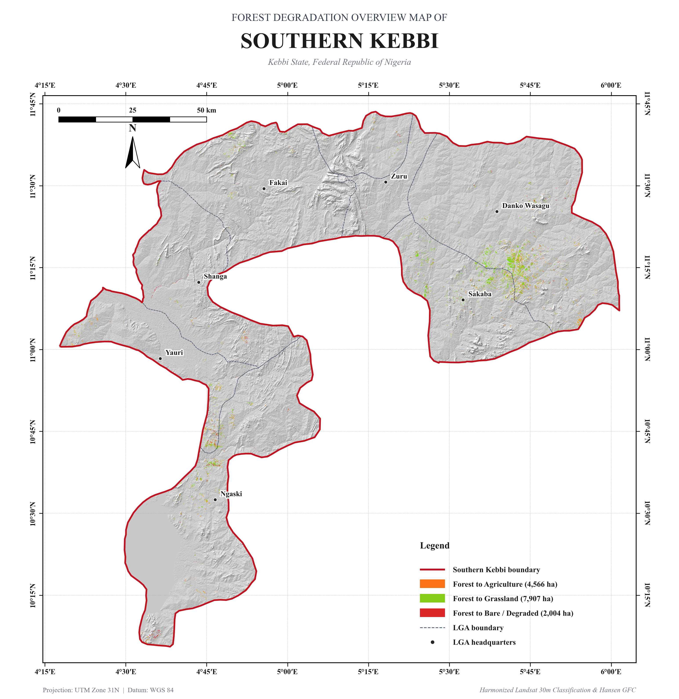<br><sub>Forest-loss transition overview</sub></td>
    <td align="center">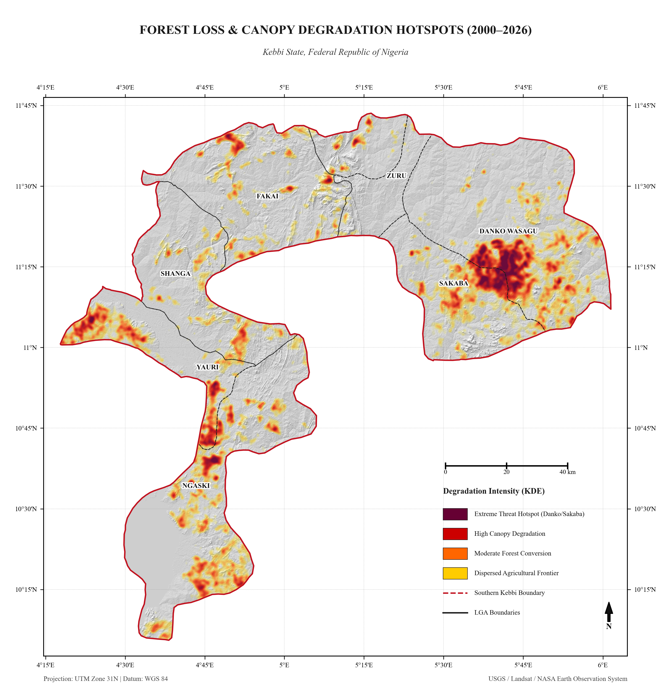<br><sub>Forest-loss hotspots (kernel density)</sub></td>
  </tr>
  <tr>
    <td align="center">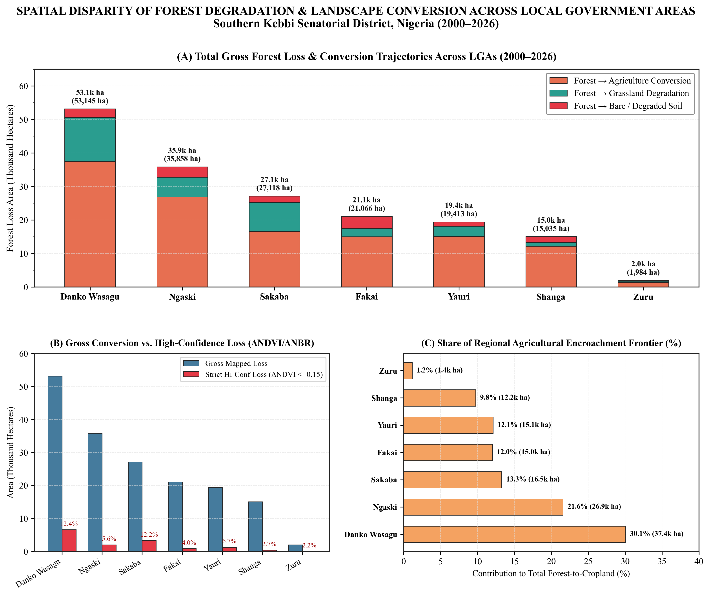<br><sub>Forest loss by LGA</sub></td>
    <td align="center">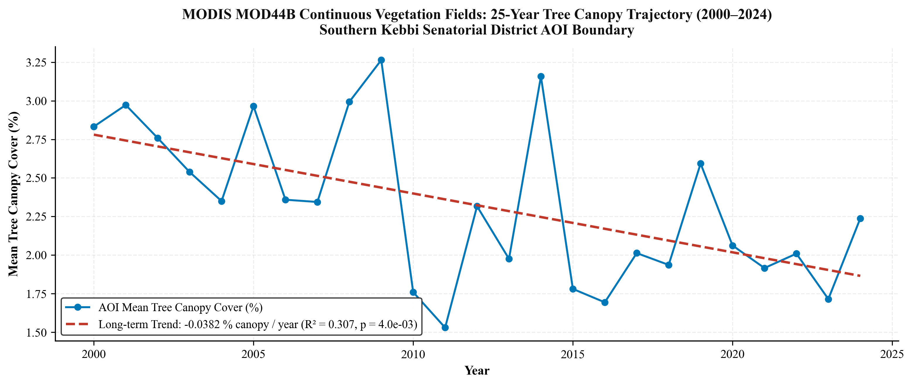<br><sub>MODIS MOD44B canopy trend</sub></td>
    <td align="center">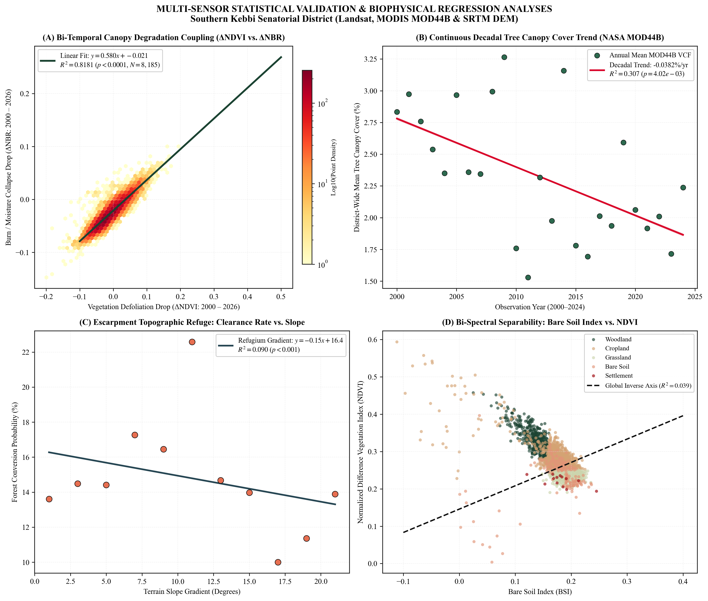<br><sub>Multi-sensor regression checks</sub></td>
  </tr>
</table>

<details>
<summary><b>All 14 map plates and 7 plots</b></summary>

| Map plate | File |
| :--- | :--- |
| Study area and topography | [`00_StudyArea.png`](outputs/maps/00_StudyArea.png) |
| True-colour composite 2000 / 2026 | [`TCC_2000.png`](outputs/maps/TCC_2000.png) · [`TCC_2026.png`](outputs/maps/TCC_2026.png) |
| Land use / land cover 2000 / 2026 | [`LULC_2000.png`](outputs/maps/LULC_2000.png) · [`LULC_2026.png`](outputs/maps/LULC_2026.png) |
| NDVI 2000 / 2026 | [`NDVI_2000.png`](outputs/maps/NDVI_2000.png) · [`NDVI_2026.png`](outputs/maps/NDVI_2026.png) |
| ΔNDVI 2000–2026 | [`NDVI_Change_2000_2026.png`](outputs/maps/NDVI_Change_2000_2026.png) |
| Transition overview | [`Transition_overview.png`](outputs/maps/Transition_overview.png) |
| Forest → agriculture / grassland / bare | [`Agriculture`](outputs/maps/Footprint_Forest_to_Agriculture.png) · [`Grassland`](outputs/maps/Footprint_Forest_to_Grassland.png) · [`Bare`](outputs/maps/Footprint_Forest_to_Bare.png) |
| Forest-loss hotspots | [`Hotspot_Forest_Loss_KDE.png`](outputs/maps/Hotspot_Forest_Loss_KDE.png) |
| Vector loss trajectories | [`Forest_Loss_Trajectories_Vector.png`](outputs/maps/Forest_Loss_Trajectories_Vector.png) |

| Plot | File |
| :--- | :--- |
| Hansen GFC annual loss 2001–2023 | [`Hansen_loss_by_year.png`](outputs/plots/Hansen_loss_by_year.png) |
| MODIS MOD44B canopy trend | [`MOD44B_VCF_trend.png`](outputs/plots/MOD44B_VCF_trend.png) |
| Per-LGA change | [`PerLGA_change.png`](outputs/plots/PerLGA_change.png) |
| Multi-sensor scatter validation | [`Seaborn_MultiSensor_Scatter_Validation.png`](outputs/plots/Seaborn_MultiSensor_Scatter_Validation.png) |
| Class spectral separability | [`Seaborn_Class_Spectral_Separability.png`](outputs/plots/Seaborn_Class_Spectral_Separability.png) |
| Confusion matrix | [`Seaborn_Confusion_Matrix.png`](outputs/plots/Seaborn_Confusion_Matrix.png) |
| Feature correlation matrix | [`Seaborn_Feature_Correlation_Matrix.png`](outputs/plots/Seaborn_Feature_Correlation_Matrix.png) |

</details>

## 🧪 Method

<p align="center">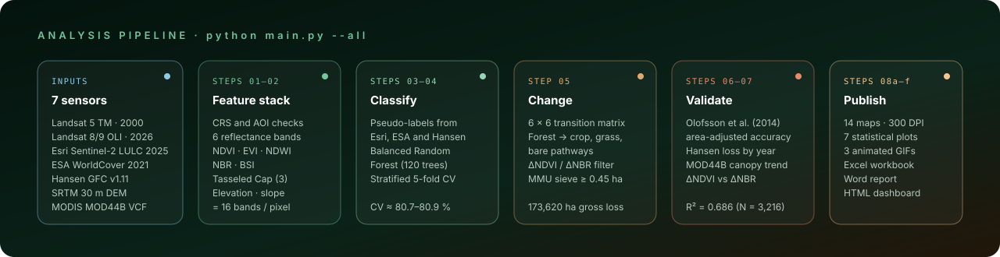</p>

| Step | Script | What it does |
| :---: | :--- | :--- |
| 01 | `step01_integrity_check.py` | Checks inputs, CRS (EPSG:32631) and AOI bounds |
| 02 | `step02_spectral_features.py` | Builds the 16-band stack: reflectance, NDVI, EVI, NDWI, NBR, BSI, Tasseled Cap, elevation and slope |
| 03 | `step03_pseudo_labels.py` | Samples pseudo-labels where Esri 2025, ESA WorldCover and Hansen agree |
| 04 | `step04_classification.py` | Class-balanced Random Forest (120 trees) with stratified 5-fold CV |
| 05 | `step05_change_detection.py` | 6 × 6 transition matrix, ΔNDVI/ΔNBR confidence filter, MMU ≥ 0.45 ha vectorisation |
| 06 | `step06_olofsson_accuracy.py` | Olofsson et al. (2014) stratified accuracy and error-adjusted areas |
| 07 | `step07_benchmarks.py` | Hansen GFC annual loss and MODIS MOD44B trend benchmarks |
| 08a–f | `step08*_*.py` | Maps, plots, Excel tables, Word report, GIFs and HTML dashboard |

Tasseled Cap uses Crist (1985) coefficients for Landsat 5 TM and Baig et al. (2014) coefficients for Landsat 8/9 OLI. Annual rates of change use the Puyravaud (2003) formula. The full mathematical treatment is in [`docs/RESEARCH_REPORT.md`](docs/RESEARCH_REPORT.md).

## 🗂️ Repository layout

```
southern-kebbi-lulc/
├── main.py                     # Pipeline orchestrator (CLI)
├── RUN_ALL.bat · run_all.sh    # One-click runners (Windows / Linux / macOS)
├── requirements.txt · environment.yml
├── assets/                     # README graphics (banner.svg, pipeline.svg)
├── data/                       # Input rasters (not in git, see data/README.md)
├── docs/
│   ├── RESEARCH_REPORT.md      # Full research report
│   ├── DATA_SOURCES.md         # Dataset provenance and citations
│   └── references.bib          # BibTeX for all cited works and datasets
├── scripts/
│   ├── pipeline/               # Steps 01 → 08f
│   ├── utilities/              # Esri 2025 LULC tile downloader
│   └── tests_and_calibration/  # Exploratory and calibration scripts
└── outputs/
    ├── maps/    (14 plates, 300 DPI)    ├── plots/   (7 figures)
    ├── gifs/    (3 animations)          ├── tables/  (Excel workbook)
    ├── vectors/ (AOI, LGAs, loss polygons)
    ├── rasters/ (summary JSON only; GeoTIFFs not in git)
    └── reports/ (HTML dashboard)
```

> Large files are kept out of git: input rasters (~1.3 GB), intermediate GeoTIFFs (~5.6 GB), the Word report (~63 MB) and the standalone dashboard (~17 MB). The Word report and standalone dashboard can be shared through a GitHub Release.

## ▶️ Reproducing the analysis

```bash
# 1. Environment
conda env create -f environment.yml && conda activate kebbi_env
#    or: pip install -r requirements.txt

# 2. Place the input rasters in data/  (see data/README.md)

# 3. Run everything
python main.py --all

# or individual stages
python main.py --check     # pre-flight data check
python main.py --step 4    # one step
python main.py --maps      # 8a  maps
python main.py --plots     # 8b  plots
python main.py --tables    # 8c  Excel
python main.py --report    # 8d  Word report
python main.py --gifs      # 8e  animations
python main.py --html      # 8f  dashboard
```

On Windows you can double-click `RUN_ALL.bat` instead.

## 🛰️ Data sources

The analysis is built on public Earth-observation data. Each dataset should be cited on its own when this work is reused; full provenance, licences and BibTeX are in [`docs/DATA_SOURCES.md`](docs/DATA_SOURCES.md) and [`docs/references.bib`](docs/references.bib).

| Dataset | Use | Provider | Citation |
| :--- | :--- | :--- | :--- |
| Landsat 5 TM Collection 2 Level-2 SR (2000) | Baseline imagery | USGS / NASA | USGS (2020a) |
| Landsat 8/9 OLI Collection 2 Level-2 SR (2026) | Target imagery | USGS / NASA | USGS (2020b) |
| Esri Sentinel-2 10 m Land Use/Land Cover (2025) | Pseudo-label benchmark | Esri / Impact Observatory / Microsoft | Karra et al. (2021) |
| ESA WorldCover 10 m 2021 v200 | Pseudo-label benchmark, settlement mask | ESA | Zanaga et al. (2022) |
| Hansen Global Forest Change v1.11 (2000–2023) | Tree cover and annual loss benchmark | UMD GLAD | Hansen et al. (2013) |
| SRTM 1 arc-second DEM | Elevation, slope, hillshade | NASA JPL | Farr et al. (2007) |
| MODIS MOD44B VCF v061 (2000–2024) | Canopy trend corroboration | NASA LP DAAC | DiMiceli et al. (2021) |
| Kebbi State LGA boundaries | Study area and zonal statistics | Administrative boundary data | See DATA_SOURCES.md |

## 📚 References

**Methods**

1. Baig, M. H. A., Zhang, L., Shuai, T., & Tong, Q. (2014). Derivation of a tasselled cap transformation based on Landsat 8 at-satellite reflectance. *Remote Sensing Letters, 5*(5), 423–431. https://doi.org/10.1080/2150704X.2014.915434
2. Breiman, L. (2001). Random forests. *Machine Learning, 45*(1), 5–32. https://doi.org/10.1023/A:1010933404324
3. Crist, E. P. (1985). A TM tasseled cap equivalent transformation for reflectance factor data. *Remote Sensing of Environment, 17*(3), 301–306. https://doi.org/10.1016/0034-4257(85)90102-6
4. Huete, A., Didan, K., Miura, T., Rodriguez, E. P., Gao, X., & Ferreira, L. G. (2002). Overview of the radiometric and biophysical performance of the MODIS vegetation indices. *Remote Sensing of Environment, 83*(1–2), 195–213. https://doi.org/10.1016/S0034-4257(02)00096-2
5. Key, C. H., & Benson, N. C. (2006). Landscape assessment (LA): Sampling and analysis methods. In *FIREMON: Fire Effects Monitoring and Inventory System* (Gen. Tech. Rep. RMRS-GTR-164-CD). USDA Forest Service, Rocky Mountain Research Station.
6. McFeeters, S. K. (1996). The use of the Normalized Difference Water Index (NDWI) in the delineation of open water features. *International Journal of Remote Sensing, 17*(7), 1425–1432. https://doi.org/10.1080/01431169608948714
7. Olofsson, P., Foody, G. M., Herold, M., Stehman, S. V., Woodcock, C. E., & Wulder, M. A. (2014). Good practices for estimating area and assessing accuracy of land change. *Remote Sensing of Environment, 148*, 42–57. https://doi.org/10.1016/j.rse.2014.02.015
8. Pedregosa, F., et al. (2011). Scikit-learn: Machine learning in Python. *Journal of Machine Learning Research, 12*, 2825–2830.
9. Puyravaud, J.-P. (2003). Standardizing the calculation of the annual rate of deforestation. *Forest Ecology and Management, 177*(1–3), 593–596. https://doi.org/10.1016/S0378-1127(02)00335-3
10. Rikimaru, A., Roy, P. S., & Miyatake, S. (2002). Tropical forest cover density mapping. *Tropical Ecology, 43*(1), 39–47.
11. Rouse, J. W., Haas, R. H., Schell, J. A., & Deering, D. W. (1974). Monitoring vegetation systems in the Great Plains with ERTS. In *Third Earth Resources Technology Satellite-1 Symposium* (NASA SP-351, Vol. 1, pp. 309–317).
12. Sedano, F., Silva, J. A., Machoco, R., Meque, C. H., Sitoe, A., Ribeiro, N., Anderson, K., Ombe, Z. A., Baule, S. H., & Tucker, C. J. (2016). The impact of charcoal production on forest degradation: A case study in Tete, Mozambique. *Environmental Research Letters, 11*(9), 094020. https://doi.org/10.1088/1748-9326/11/9/094020

**Datasets**

13. DiMiceli, C., Townshend, J., Carroll, M., & Sohlberg, R. (2021). *MODIS/Terra Vegetation Continuous Fields Yearly L3 Global 250m SIN Grid V061* [Data set]. NASA EOSDIS Land Processes DAAC. https://doi.org/10.5067/MODIS/MOD44B.061
14. Farr, T. G., et al. (2007). The Shuttle Radar Topography Mission. *Reviews of Geophysics, 45*(2), RG2004. https://doi.org/10.1029/2005RG000183
15. Hansen, M. C., Potapov, P. V., Moore, R., Hancher, M., Turubanova, S. A., Tyukavina, A., et al. (2013). High-resolution global maps of 21st-century forest cover change. *Science, 342*(6160), 850–853. https://doi.org/10.1126/science.1244693
16. Karra, K., Kontgis, C., Statman-Weil, Z., Mazzariello, J. C., Mathis, M., & Brumby, S. P. (2021). Global land use/land cover with Sentinel 2 and deep learning. In *2021 IEEE International Geoscience and Remote Sensing Symposium (IGARSS)* (pp. 4704–4707). https://doi.org/10.1109/IGARSS47720.2021.9553499
17. U.S. Geological Survey. (2020a). *Landsat 4-5 Thematic Mapper Level-2, Collection 2* [Data set]. https://doi.org/10.5066/P9IAXOVV
18. U.S. Geological Survey. (2020b). *Landsat 8-9 Operational Land Imager / Thermal Infrared Sensor Level-2, Collection 2* [Data set]. https://doi.org/10.5066/P9OGBGM6
19. Zanaga, D., Van De Kerchove, R., Daems, D., De Keersmaecker, W., Brockmann, C., Kirches, G., et al. (2022). *ESA WorldCover 10 m 2021 v200* [Data set]. Zenodo. https://doi.org/10.5281/zenodo.7254221

**Software:** rasterio, GeoPandas, Shapely, pyproj, NumPy, SciPy, scikit-learn, Matplotlib, seaborn, Pillow, python-docx and openpyxl.

## 👥 Credits

| Role | Name | Affiliation |
| :--- | :--- | :--- |
| Analysis, pipeline development, cartography | **Satwik K Udupi** | Junior Research Fellow (JRF), CCCSS, SUK · PravahaTattva Solutions, Karad |
| Doctoral research and research ownership | **Yazid Abubakar Fakai** | PhD Scholar |

## 📝 How to cite

If you refer to this work, please cite:

> Fakai, Y. A., & Udupi, S. K. (2026). *Multi-decadal land use and land cover dynamics, canopy degradation trajectories, and multi-sensor ground-truthing in the Sudan–Guinea savanna transition zone: A 25-year remote sensing assessment of Southern Kebbi, Nigeria (2000–2026)* [Doctoral research]. 

```bibtex
@phdthesis{Fakai2026SouthernKebbi,
  author = {Fakai, Yazid Abubakar and Udupi, Satwik K},
  title  = {Multi-Decadal Land Use and Land Cover Dynamics, Canopy Degradation
            Trajectories, and Multi-Sensor Ground-Truthing in the Sudan--Guinea
            Savanna Transition Zone: A 25-Year Remote Sensing Assessment of
            Southern Kebbi, Nigeria (2000--2026)},
  year   = {2026},
  type   = {Doctoral research},
  note   = {Source code and outputs: Southern Kebbi LULC repository}
}
```

GitHub also reads [`CITATION.cff`](CITATION.cff) and shows a **"Cite this repository"** button in the sidebar.

## ⚖️ Licence and ownership

**Copyright © 2026 Yazid Abubakar Fakai. All rights reserved.**  
Analysis and software developed by Satwik K Udupi (JRF, CCCSS, SUK · PravahaTattva Solutions, Karad) in collaboration with Yazid Abubakar Fakai.

This repository is public so the research can be seen, reviewed and cited. It is **not** open-source. Copying, modifying, redistributing or reusing the code, maps, figures or text, in whole or in part, requires prior written permission from the author. Third-party datasets keep their own licences; see [`docs/DATA_SOURCES.md`](docs/DATA_SOURCES.md). For permissions or collaboration, contact the authors.

<p align="center"><sub>Southern Kebbi · Kebbi State · Federal Republic of Nigeria</sub></p>
